<div align="center">


# TallerYa

**Encuentra y reserva tu taller mecánico en minutos.**
Plataforma web open source para buscar talleres mecánicos en Santiago de Chile, verlos en un mapa, agendar hora en línea y pagar la reparación.

[](https://github.com/nibrill/tallerya/actions/workflows/ci.yml)


[](LICENSE)

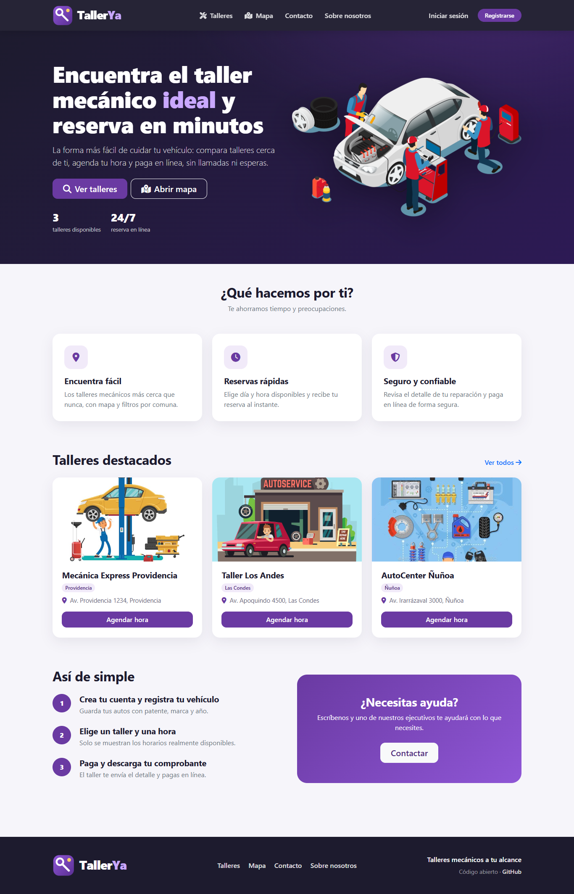

</div>

> **TallerYa** es un sistema de reservas para talleres mecánicos (app de agendamiento de citas, directorio de talleres y gestión de reparaciones) hecho con **Django**. Nació como proyecto universitario (Duoc UC) y fue renovado: nuevo diseño, seguridad reforzada, tests automáticos y despliegue con un comando.

## Índice

- [Características](#-características)
- [Capturas de pantalla](#-capturas-de-pantalla)
- [Probar en 1 minuto](#-probar-en-1-minuto)
- [Cuentas de demostración](#-cuentas-de-demostración)
- [Configuración](#%EF%B8%8F-configuración)
- [Despliegue](#-despliegue)
- [Tests y calidad](#-tests-y-calidad)
- [Documentación](#-documentación)
- [Hoja de ruta](#-hoja-de-ruta)
- [Contribuir](#-contribuir)

## ✨ Características

| Rol | Qué puede hacer |
|---|---|
| 🚗 **Cliente** | Registrarse, guardar sus vehículos, buscar talleres por nombre o comuna, ver el mapa, **reservar hora** (lun–vie, 9:00–18:00, sin doble reserva), pagar en línea (PayPal sandbox) y descargar su comprobante en Word. |
| 🔧 **Encargado de taller** | Ver las reservas de su taller, emitir el reporte de pago de cada reparación y enviar tickets al administrador. |
| 🛡️ **Administrador** | Panel con métricas; CRUD de talleres (con geocodificación de la dirección), usuarios, tickets y mensajes de contacto. |

Además: **API REST** con permisos por rol, **SEO** básico (metadatos Open Graph, `robots.txt`, `sitemap.xml`), diseño **responsive** y comando `seed` para datos de ejemplo.

## 📸 Capturas de pantalla

| Talleres | Mapa interactivo |
|---|---|
| 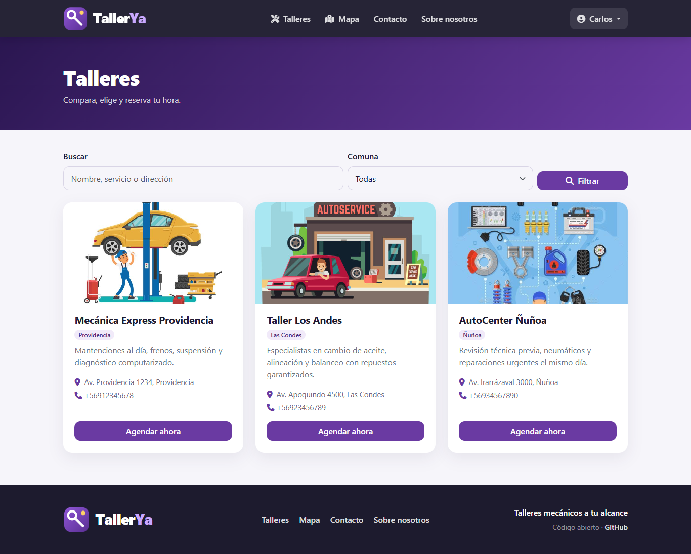 | 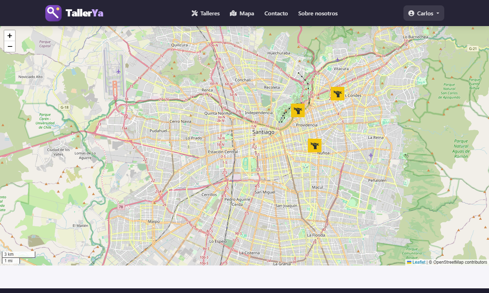 |
| **Reservar hora** | **Mis reservas** |
| 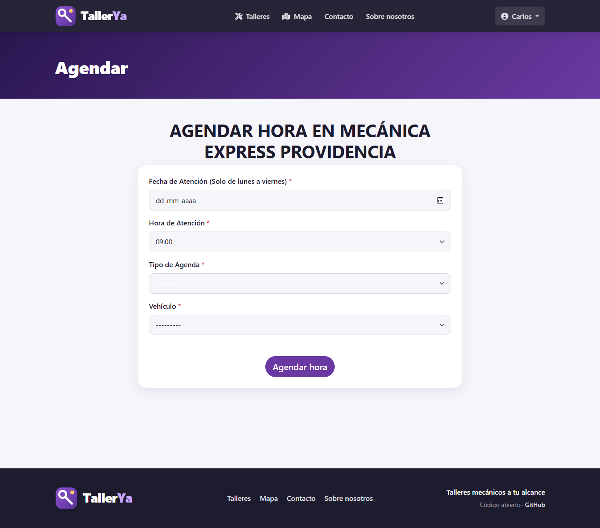 | 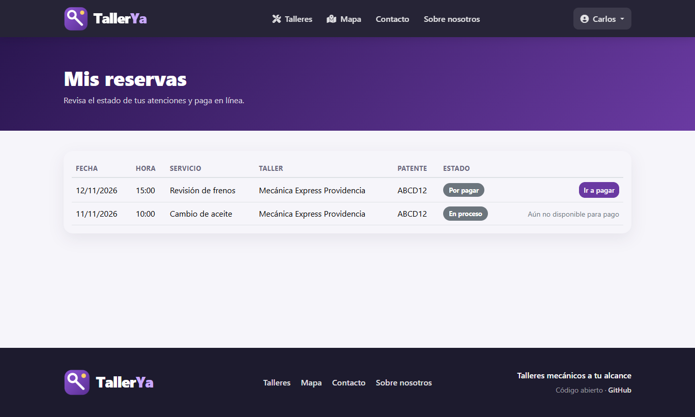 |
| **Panel del encargado** | **Panel de administración** |
| 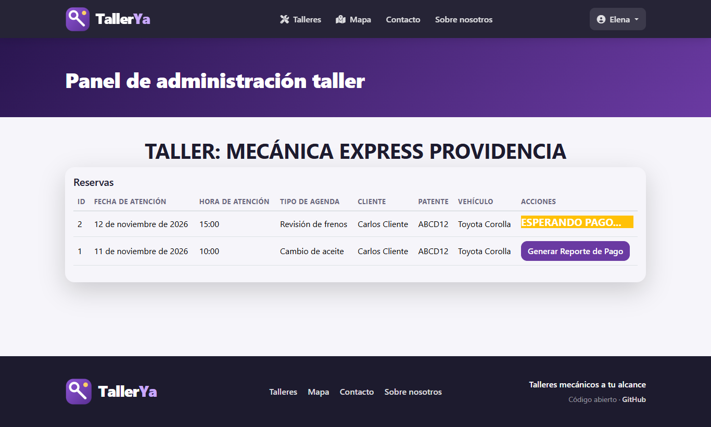 | 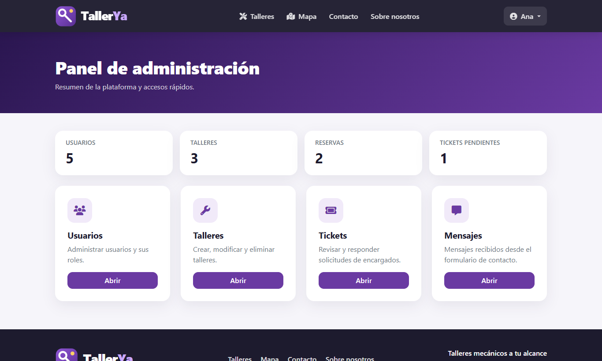 |

<details>
<summary>Versión móvil y más pantallas</summary>

<p>
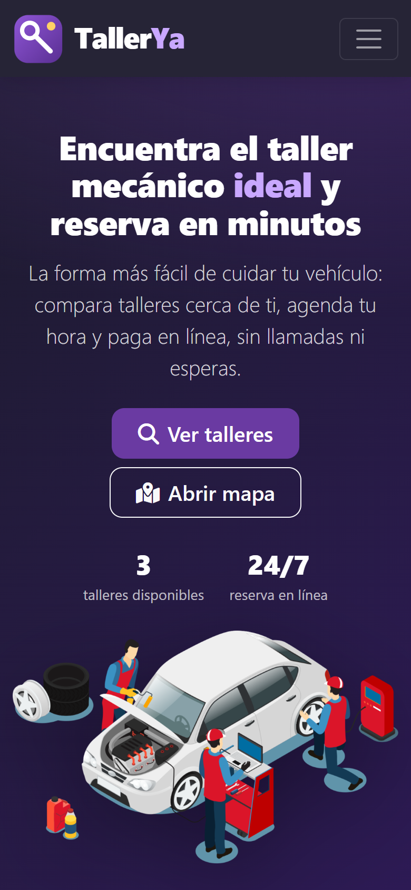
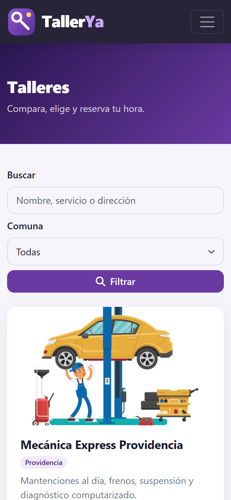
</p>

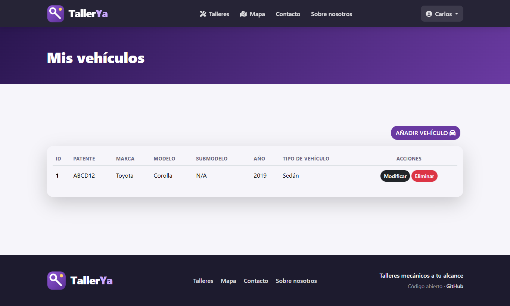
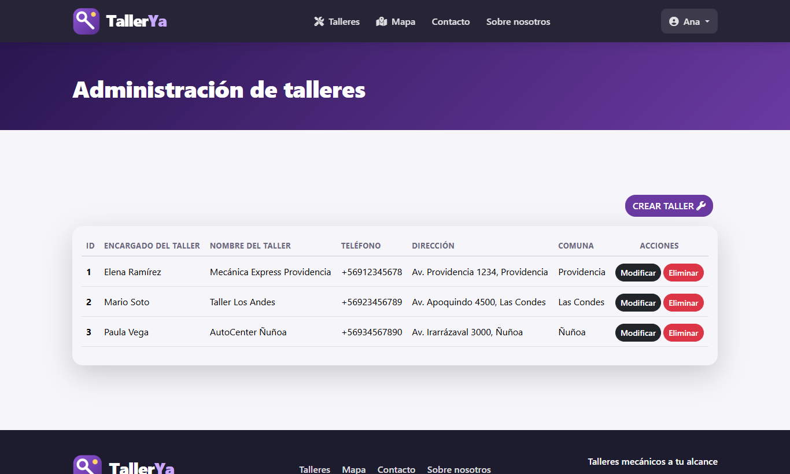
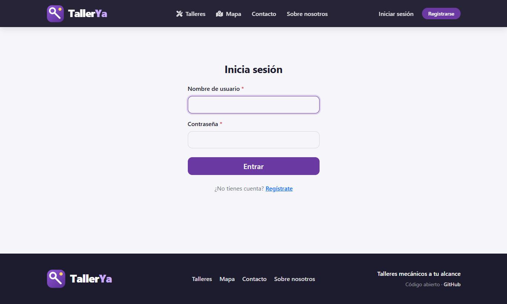

</details>

Las capturas se regeneran con [`scripts/capture_screenshots.py`](scripts/capture_screenshots.py).

## 🚀 Probar en 1 minuto

Requisitos: Python 3.10 o superior. No necesitas instalar ninguna base de datos (usa SQLite).

```bash
git clone https://github.com/nibrill/tallerya.git
cd tallerya

python -m venv .venv
# Windows: .venv\Scripts\activate        Linux/macOS: source .venv/bin/activate

pip install -r requirements.txt
python manage.py migrate
python manage.py seed --demo      # catálogos + usuarios, talleres y reservas de ejemplo
python manage.py runserver
```

Abre <http://127.0.0.1:8000>.

**Con Docker:**

```bash
docker compose up --build
```

## 👤 Cuentas de demostración

`seed --demo` crea estas cuentas con la clave `tallerya123` (**solo para desarrollo, nunca en producción**):

| Usuario | Rol |
|---|---|
| `cliente` | Cliente |
| `encargado1` · `encargado2` · `encargado3` | Encargado de taller |
| `admin` | Administrador |

Sin `--demo`, `python manage.py seed` solo carga los catálogos (roles, comunas, marcas, tipos de servicio). Para producción crea tu administrador con `python manage.py createsuperuser`.

## ⚙️ Configuración

Todo se configura con variables de entorno (ver [`.env.example`](.env.example)):

| Variable | Descripción | Por defecto |
|---|---|---|
| `DJANGO_DEBUG` | Pon `False` en producción | `True` |
| `DJANGO_SECRET_KEY` | **Obligatoria** si `DEBUG=False` | clave de desarrollo |
| `DJANGO_ALLOWED_HOSTS` | Hosts permitidos, separados por coma | `localhost,127.0.0.1` |
| `DJANGO_CSRF_TRUSTED_ORIGINS` | Orígenes `https://…` de confianza | — |
| `DB_ENGINE` | `sqlite` o `mysql` | `sqlite` |
| `DB_NAME` `DB_HOST` `DB_PORT` `DB_USER` `DB_PASSWORD` | Conexión MySQL (requiere `mysqlclient`) | — |
| `OPENCAGE_API_KEY` | Opcional. Sin ella se geocodifica con OpenStreetMap (Nominatim) | — |
| `SERVE_MEDIA` | `True` sirve `/media/` desde Django (solo demos) | `False` |
| `SEED_ARGS` | Argumentos de `seed` al arrancar el contenedor (`--demo`) | — |

## 🌐 Despliegue

- **Render:** el archivo [`render.yaml`](render.yaml) define el servicio (Blueprint). Crea un *New → Blueprint* apuntando a este repositorio.
- **Docker:** [`Dockerfile`](Dockerfile) y [`docker-compose.yml`](docker-compose.yml) listos para usar. El contenedor migra la base de datos, carga los catálogos y arranca `gunicorn`.
- **Servidor propio:** `DJANGO_DEBUG=False`, `python manage.py collectstatic`, `gunicorn tallerya.wsgi`. Los estáticos los sirve WhiteNoise. Para producción real usa MySQL/PostgreSQL y un almacenamiento persistente para las imágenes subidas.

## 🧪 Tests y calidad

```bash
python manage.py test
```

21 tests cubren páginas por rol, permisos, reservas (horas ocupadas, fines de semana, fechas pasadas), reporte de pago, API y formularios. Se ejecutan automáticamente en cada *push* con GitHub Actions.

## 📚 Documentación

- [Arquitectura](docs/ARCHITECTURE.md) — modelos, roles, flujos y estructura del código
- [API REST](docs/API.md) — endpoints y permisos
- [Seguridad](SECURITY.md) — política y mejoras aplicadas
- [Cambios](CHANGELOG.md) — historial de versiones
- [Contribuir](CONTRIBUTING.md)

## 🗺️ Hoja de ruta

- [ ] Reseñas y calificaciones de talleres
- [ ] Notificaciones por correo de reservas
- [ ] Horarios y servicios configurables por taller
- [ ] Pasarela de pago real (Webpay / Mercado Pago)
- [ ] Internacionalización y modo oscuro

¿Tienes una idea? Abre un [issue](https://github.com/nibrill/tallerya/issues/new/choose).

## 🤝 Contribuir

Las contribuciones son bienvenidas. Lee [CONTRIBUTING.md](CONTRIBUTING.md) para ver cómo preparar el entorno y enviar un *pull request*.

## 📄 Licencia

Distribuido bajo licencia [MIT](LICENSE).

---

<sub>Palabras clave: taller mecánico, reservar hora taller, agendar mecánico, app de talleres Chile, sistema de reservas Django, directorio de talleres mecánicos.</sub>
