<div align="center">


# Garage360

**Plataforma de gestión y reservas para talleres mecánicos.**
Directorio geolocalizado, agendamiento de citas, reportes de pago y paneles por rol.

[](https://github.com/nibrill/garage360/actions/workflows/ci.yml)


[](LICENSE)


</div>

**Garage360** es una aplicación web full-stack construida con **Django + MySQL + HTML/Bootstrap** para que clientes encuentren talleres mecánicos, reserven hora en línea y paguen sus reparaciones, y para que los talleres y administradores gestionen su operación. Es un proyecto descargable y autocontenido: se levanta con un solo comando.

## Índice

[Stack](#-stack-tecnológico) · [Características](#-características) · [Capturas](#-capturas-de-pantalla) · [Instalación](#-instalación) · [Cuentas demo](#-cuentas-de-demostración) · [Configuración](#%EF%B8%8F-configuración) · [Tests](#-tests-y-calidad) · [Despliegue](#-despliegue) · [Documentación](#-documentación) · [Hoja de ruta](#-hoja-de-ruta)

## 🧱 Stack tecnológico

| Capa | Tecnología |
|---|---|
| Backend | Django 5.2 / 6.0, Django REST Framework, Python 3.10+ |
| Base de datos | **MySQL 8** (utf8mb4, InnoDB) · driver PyMySQL |
| Frontend | HTML5 + plantillas Django, Bootstrap 5, sistema de diseño propio (CSS), JavaScript sin dependencias, Leaflet |
| Infraestructura | Docker / Docker Compose, Gunicorn, WhiteNoise |
| Calidad | 24 tests automáticos, GitHub Actions (MySQL 8 + SQLite) |

## ✨ Características

| Rol | Qué puede hacer |
|---|---|
| 🚗 **Cliente** | Registrarse, guardar sus vehículos, buscar talleres por nombre o comuna, ver el mapa, **reservar hora** (lun–vie, 9:00–18:00, sin doble reserva), pagar en línea (PayPal sandbox o modo demo) y descargar su comprobante en Word. |
| 🔧 **Encargado de taller** | Ver las reservas de su taller, emitir el reporte de pago de cada reparación y enviar tickets al administrador. |
| 🛡️ **Administrador** | Panel con métricas; CRUD de talleres (con geocodificación de la dirección), usuarios, tickets y mensajes de contacto. |

Además: **API REST** con permisos por rol, SEO básico (Open Graph, `robots.txt`, `sitemap.xml`), diseño responsive y comando `seed` para datos de ejemplo.

## 📸 Capturas de pantalla

Interfaz **oscura por defecto** con modo claro, animaciones suaves, vidrio esmerilado y diseño responsive. El tema se cambia con el botón del menú y se recuerda entre visitas.

| Modo oscuro | Modo claro |
|---|---|
|  | 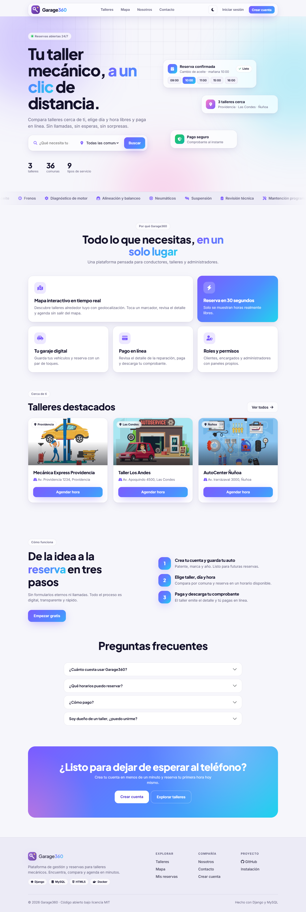 |

| Directorio de talleres | Mapa interactivo |
|---|---|
|  | 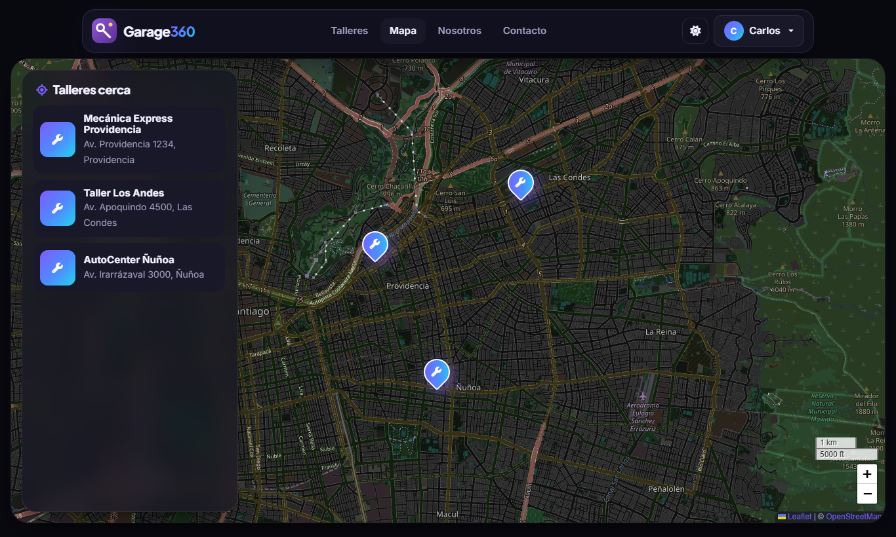 |
| **Reservar hora** | **Pago de la reparación** |
| 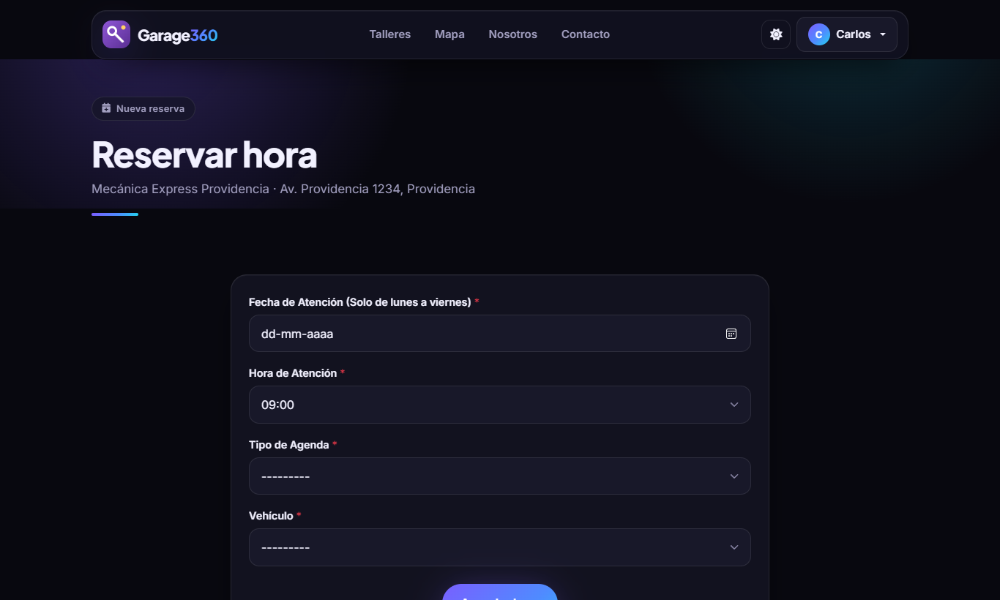 | 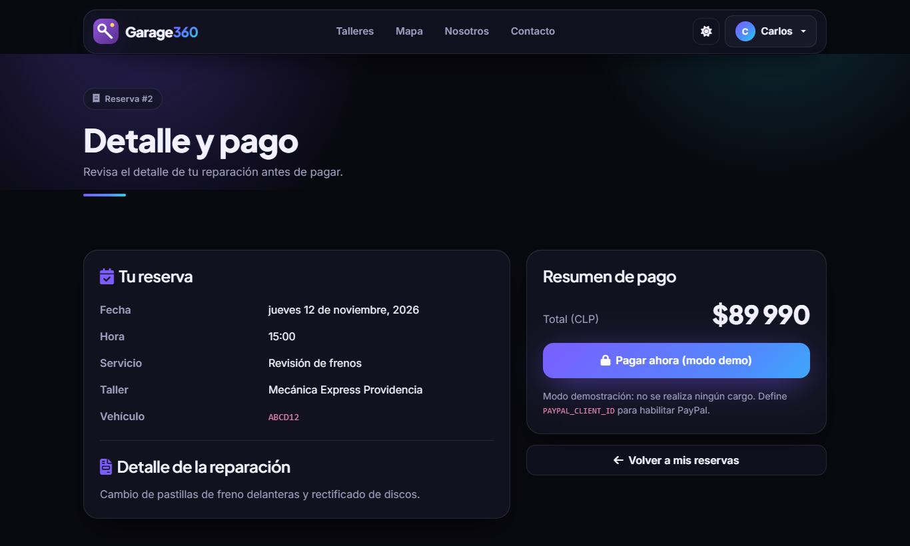 |
| **Mis reservas** | **Panel del encargado** |
| 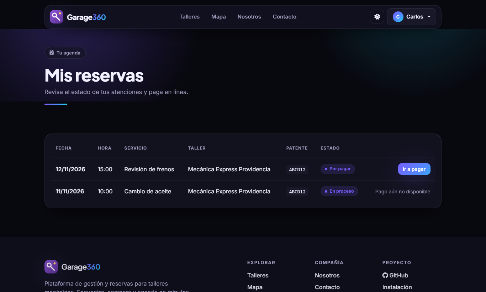 | 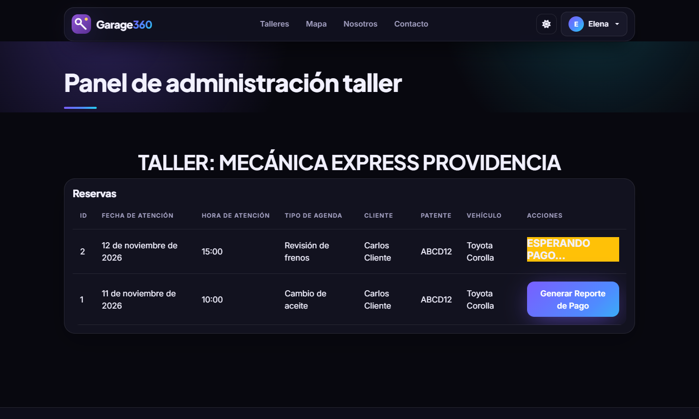 |
| **Panel de administración** | **Inicio de sesión** |
| 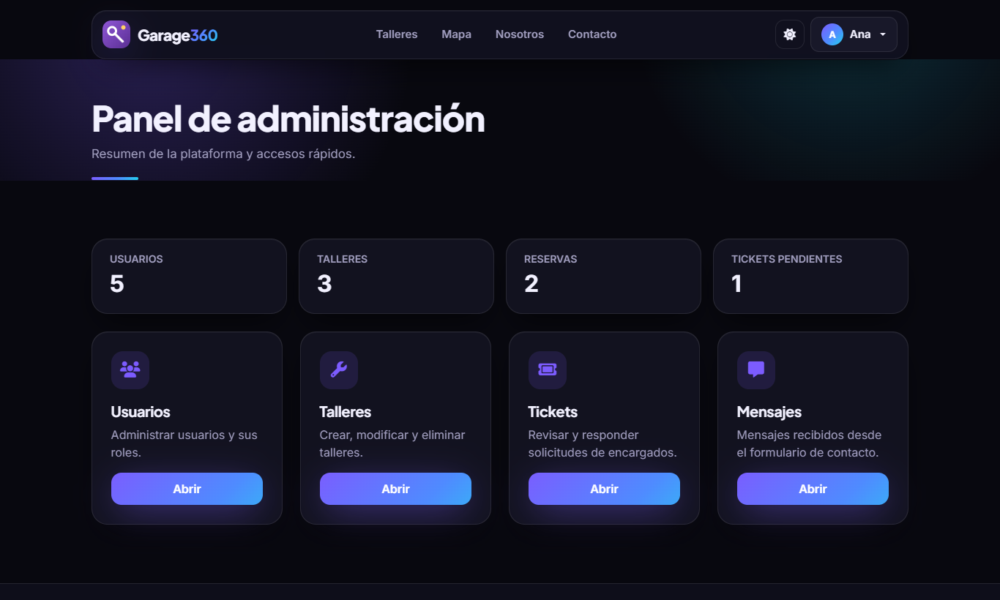 | 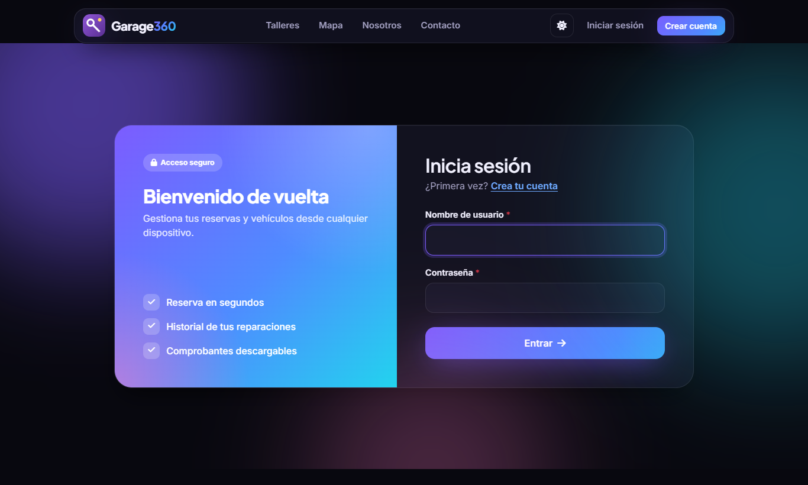 |

<details>
<summary>Versión móvil y más pantallas</summary>

<p>


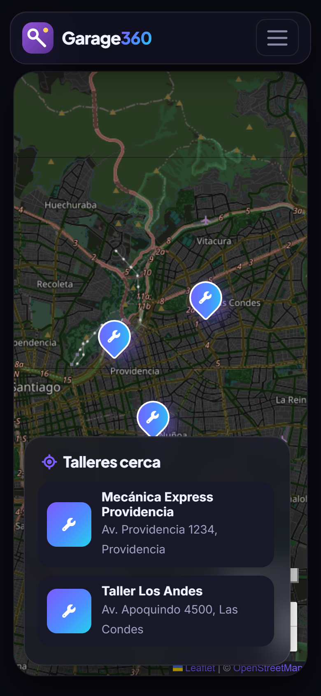
</p>

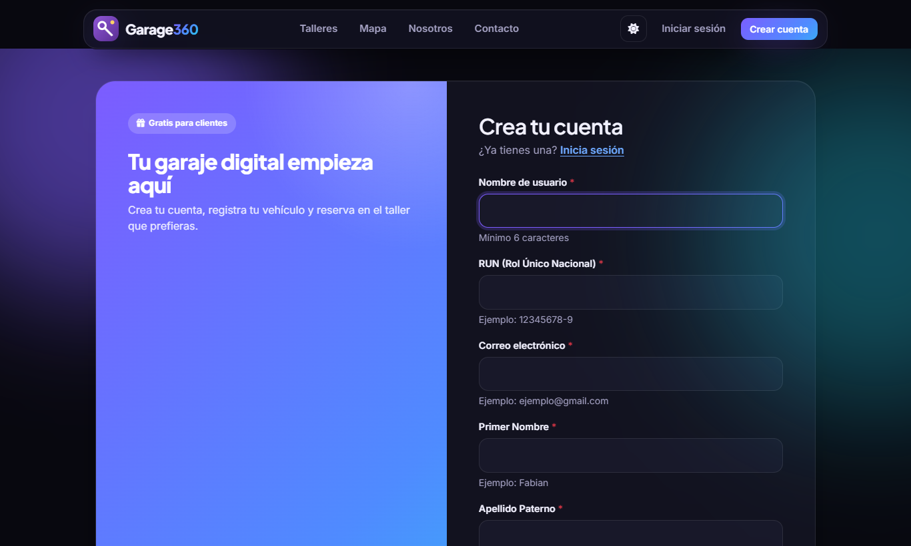
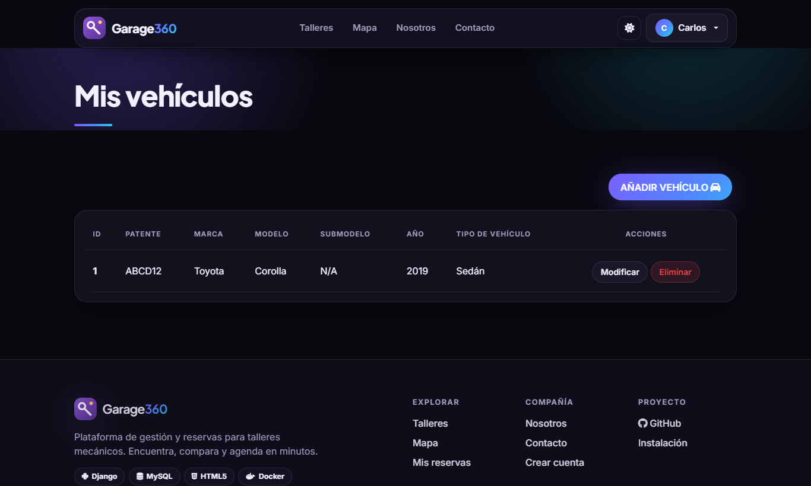
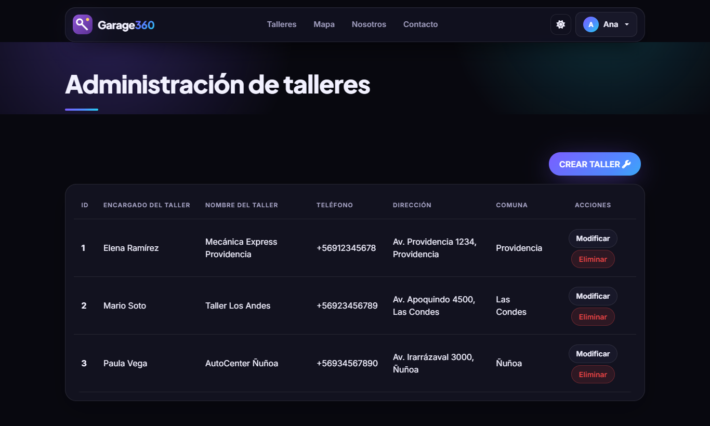


</details>

## 🚀 Instalación

### Opción A · Docker (la más rápida)

Requiere [Docker](https://www.docker.com/). Levanta la web **y** MySQL con datos de ejemplo:

```bash
git clone https://github.com/nibrill/garage360.git
cd garage360
docker compose up --build
```

Abre <http://localhost:8000>.

### Opción B · Instalación local con MySQL

Requisitos: Python 3.10+ y MySQL 8.x en ejecución.

```bash
git clone https://github.com/nibrill/garage360.git
cd garage360

# 1. Base de datos (crea la BD `garage360` y el usuario de la app)
mysql -u root -p < database/init.sql

# 2. Entorno Python
python -m venv .venv
# Windows: .venv\Scripts\activate        Linux/macOS: source .venv/bin/activate
pip install -r requirements.txt

# 3. Tablas y datos
python manage.py migrate
python manage.py seed --demo        # catálogos + usuarios, talleres y reservas de ejemplo

# 4. Servidor
python manage.py runserver
```

Abre <http://127.0.0.1:8000>. Los valores de conexión por defecto coinciden con `database/init.sql`; ajústalos con variables de entorno (ver [`.env.example`](.env.example) y [docs/DATABASE.md](docs/DATABASE.md)).

> ¿Solo quieres echar un vistazo sin MySQL? `DB_ENGINE=sqlite python manage.py migrate` usa un archivo SQLite (solo para desarrollo).

## 👤 Cuentas de demostración

`seed --demo` crea estas cuentas con la clave `garage360123` (**solo desarrollo, nunca en producción**):

| Usuario | Rol |
|---|---|
| `cliente` | Cliente |
| `encargado1` · `encargado2` · `encargado3` | Encargado de taller |
| `admin` | Administrador |

Sin `--demo`, `python manage.py seed` solo carga los catálogos (roles, comunas, marcas, tipos de servicio). Para producción crea tu administrador con `python manage.py createsuperuser`.

## ⚙️ Configuración

Todo se configura con variables de entorno (ver [`.env.example`](.env.example)):

| Variable | Descripción | Por defecto |
|---|---|---|
| `DJANGO_DEBUG` | Pon `False` en producción | `True` |
| `DJANGO_SECRET_KEY` | **Obligatoria** si `DEBUG=False` | clave de desarrollo |
| `DJANGO_ALLOWED_HOSTS` | Hosts permitidos, separados por coma | `localhost,127.0.0.1` |
| `DJANGO_CSRF_TRUSTED_ORIGINS` | Orígenes `https://…` de confianza | — |
| `DB_ENGINE` | `mysql` o `sqlite` (solo desarrollo) | `mysql` |
| `DB_NAME` `DB_HOST` `DB_PORT` `DB_USER` `DB_PASSWORD` | Conexión MySQL | `garage360` · `127.0.0.1` · `3306` · `garage360` · `garage360_dev` |
| `OPENCAGE_API_KEY` | Opcional. Sin ella se geocodifica con OpenStreetMap (Nominatim) | — |
| `PAYPAL_CLIENT_ID` | Opcional. Client ID de PayPal sandbox; sin él el pago funciona en modo demo | — |
| `SERVE_MEDIA` | `True` sirve `/media/` desde Django (solo demos) | `False` |

## 🧪 Tests y calidad

```bash
python manage.py test        # el usuario de BD necesita permisos sobre test_garage360 (ver database/init.sql)
```

24 tests cubren páginas por rol, permisos, reservas (horas ocupadas, fines de semana, fechas pasadas), reporte de pago, API y formularios. Se ejecutan en cada *push* contra **MySQL 8** y SQLite con GitHub Actions.

## 🌐 Despliegue

- **Docker Compose** (VPS, servidor propio): [`docker-compose.yml`](docker-compose.yml) ya define la web y MySQL con volumen persistente. Antes de exponerlo cambia `DJANGO_SECRET_KEY` y las contraseñas, quita `SEED_ARGS: "--demo"` y pon `DJANGO_SECURE_COOKIES` en `True` detrás de HTTPS.
- **Sin Docker:** `DJANGO_DEBUG=False`, `python manage.py collectstatic`, `gunicorn garage360.wsgi`. Los estáticos los sirve WhiteNoise. Las imágenes subidas (`media/`) necesitan almacenamiento persistente.
- **MySQL administrado** (RDS, Aiven, Cloud SQL…): basta con apuntar las variables `DB_*`.

## 📚 Documentación

- [Arquitectura](docs/ARCHITECTURE.md) — modelo de datos, roles, flujos y estructura del código
- [Base de datos](docs/DATABASE.md) — MySQL, esquema, respaldo y driver
- [API REST](docs/API.md) — endpoints y permisos
- [Seguridad](SECURITY.md) · [Cambios](CHANGELOG.md) · [Contribuir](CONTRIBUTING.md)

## 🗺️ Hoja de ruta

- [ ] Reseñas y calificaciones de talleres
- [ ] Notificaciones por correo de reservas
- [ ] Horarios y servicios configurables por taller
- [ ] Pasarela de pago real (Webpay / Mercado Pago)
- [ ] Modo oscuro e internacionalización

¿Tienes una idea? Abre un [issue](https://github.com/nibrill/garage360/issues/new/choose).

## 🤝 Contribuir

Las contribuciones son bienvenidas: lee [CONTRIBUTING.md](CONTRIBUTING.md).

## 📄 Licencia

Distribuido bajo licencia [MIT](LICENSE).

---

<sub>Palabras clave: sistema de gestión de talleres mecánicos, reserva de citas para taller, agendamiento mecánico, app de talleres Chile, Django MySQL, directorio de talleres.</sub>
