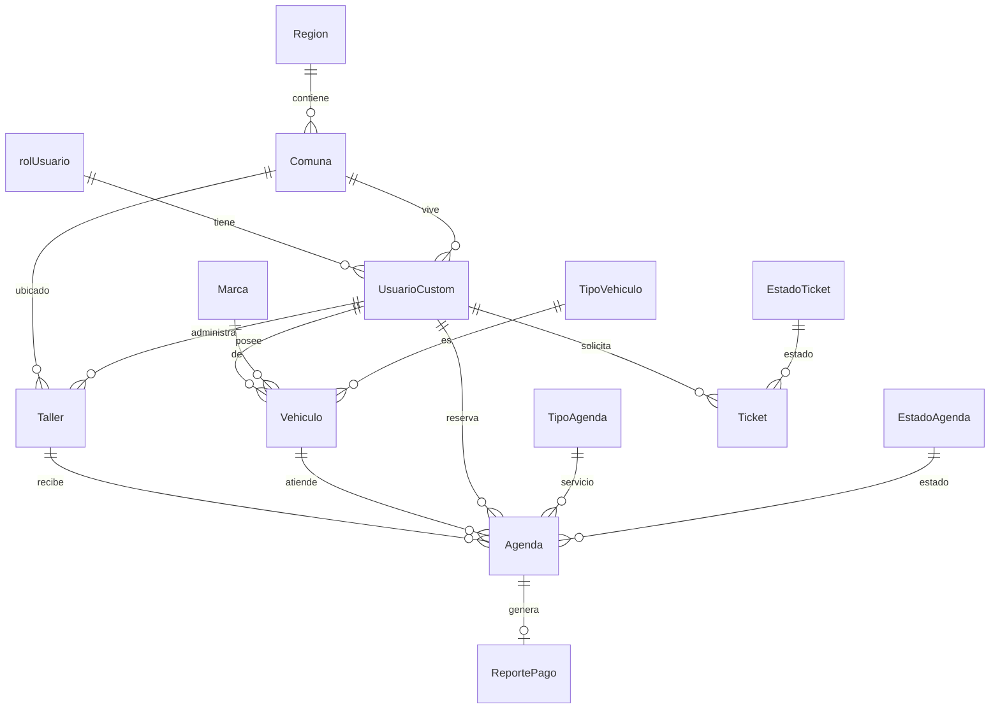
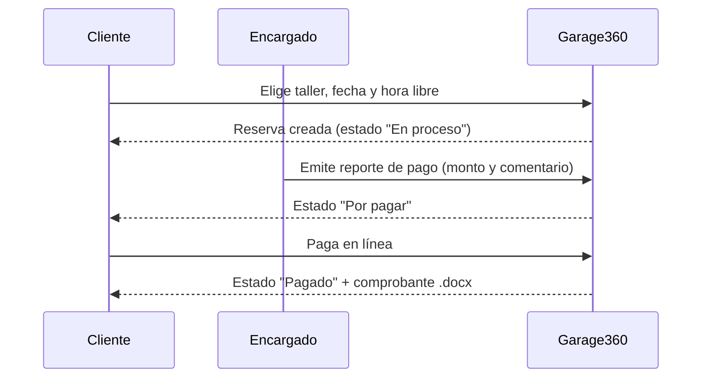

# Arquitectura

Garage360 es una aplicación Django monolítica con una única app (`core`) y plantillas renderizadas en el servidor (Bootstrap 5 + un poco de jQuery/SweetAlert2).

```
garage360/                 Proyecto Django (settings, urls, wsgi/asgi)
core/
  models.py               Modelo de datos
  views.py                Vistas, decoradores de rol y ViewSets de la API
  forms.py                Formularios y validaciones
  geo.py                  Geocodificación (OpenCage opcional / Nominatim)
  serializers.py          Serializadores DRF
  urls.py                 Rutas y router de la API
  templatetags/ui.py      Filtros para renderizar formularios con Bootstrap
  management/commands/seed.py   Catálogos y datos de demostración
  templates/ static/      Interfaz
scripts/capture_screenshots.py  Genera las capturas de docs/screenshots
```

## Modelo de datos



`Contacto` almacena los mensajes del formulario público de contacto.

## Interfaz

- **Sistema de diseño** en `core/static/core/css/style.css`: variables CSS (`--g-*`) con tema oscuro/claro mediante `data-bs-theme` de Bootstrap 5.3. Componentes reutilizables: `.glass-card`, `.tile` (bento), `.taller-card`, `.page-hero`, `.filter-bar`, `.auth-card`, `.pill`, `.estado-pill`.
- **JavaScript** en `core/static/core/js/main.js` (sin dependencias): cambio de tema, animaciones al hacer scroll (`.reveal`), contadores, brillo bajo el cursor y confirmaciones (`data-confirm`).
- Las plantillas heredan de `core/base.html`; los formularios se renderizan con `core/_form_fields.html`.
- Se respeta `prefers-reduced-motion` y `prefers-color-scheme`.

## Roles y permisos

| Rol | Acceso |
|---|---|
| Cliente | Talleres, mapa, sus vehículos y sus reservas, pago |
| Encargado taller | Reservas y reportes de pago de **su** taller, tickets propios |
| Administrador | Todo lo anterior + talleres, usuarios, tickets, mensajes |

El control se hace con el decorador `role_required` (redirige a login si no hay sesión, responde 403 si falta el rol) y verificaciones de propiedad en cada vista que recibe un id. Las acciones que modifican datos (eliminar, aceptar/rechazar) exigen `POST` con token CSRF.

## Flujo de una reserva



Las horas disponibles son de 9:00 a 18:00, de lunes a viernes; una hora ya reservada en un taller se rechaza en el formulario y en la consulta AJAX de horas libres.

## Geolocalización

`core/geo.py` convierte direcciones en coordenadas. Usa OpenCage si hay `OPENCAGE_API_KEY`; si no, Nominatim (OpenStreetMap). Solo se aceptan direcciones de la Región Metropolitana. El mapa usa Leaflet y teselas de OpenStreetMap.

## Decisiones de diseño

- **MySQL 8 (InnoDB, utf8mb4)** como base de datos del proyecto; claves foráneas y transacciones gestionadas por el ORM de Django. Ver [DATABASE.md](DATABASE.md).
- **PyMySQL** como driver por defecto: puro Python, sin compilar, funciona igual en Windows, Linux y Docker. Si existe `mysqlclient`, se usa en su lugar.
- **Sin servicios de pago obligatorios**: la geocodificación y el mapa funcionan sin claves de API.
- **WhiteNoise** para estáticos y **gunicorn** como servidor, de modo que la misma imagen sirva en cualquier plataforma.
- **SQLite solo como atajo de desarrollo** (`DB_ENGINE=sqlite`); el CI prueba ambos motores.
